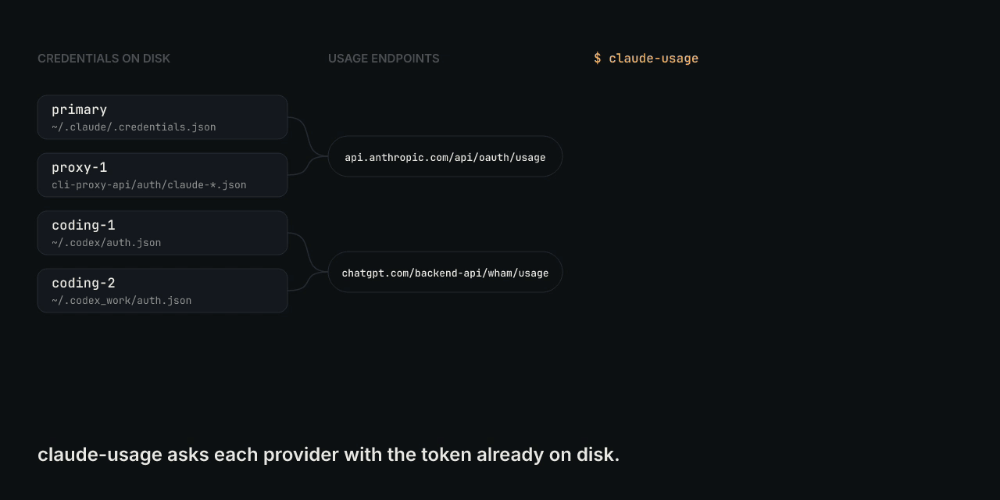
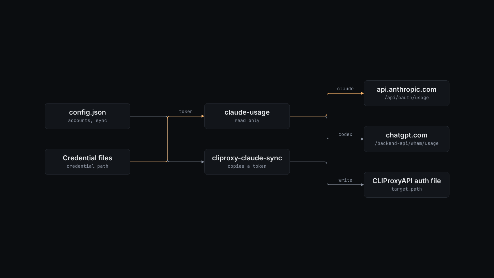

# agent-usage

How much Claude and Codex quota you have left, across every account you pay for.

Two small scripts for people who run several Claude and Codex subscriptions. `claude-usage` prints how much of each account's plan quota is used. `cliproxy-claude-sync` copies a Claude Code sign-in into a CLIProxyAPI auth file.



## Why

Claude and Codex plans limit use per time window, and each account shows its own numbers only in its own app or web page. With two Claude accounts and two Codex accounts, you check four places before you decide which account takes the next large job. `claude-usage` asks each provider's usage endpoint with the token that is already on disk and prints one line per window, in about 3 seconds for four accounts on this machine. It never prints a token.

CLIProxyAPI can serve a Claude sign-in to other tools, but if it refreshes the token itself, Claude Code and the proxy fight over the same sign-in. `cliproxy-claude-sync` lets Claude Code keep renewal and gives the proxy a copy of the current access token with no refresh token.

## Install

Requirements:

- Python 3 (tested with 3.12.3). The scripts use only the standard library.
- Network access to `api.anthropic.com` and `chatgpt.com`.
- Signed-in Claude Code or Codex CLI accounts, so their credential files exist.
- For `cliproxy-claude-sync`, the `claude` CLI on `PATH` and an existing CLIProxyAPI auth file.

1. Put the scripts on your `PATH`:

   ```bash
   install -m 755 claude-usage cliproxy-claude-sync ~/.local/bin/
   ```

2. Create the config at the default path and keep it private:

   ```bash
   mkdir -p ~/.config/agent-usage
   install -m 600 config.example.json ~/.config/agent-usage/config.json
   ```

3. Edit `~/.config/agent-usage/config.json`. Give each account a name and point `credential_path` at its credential file. The [Configuration](#configuration) section lists the fields.

## Quick start

Print usage for every account in the config:

```console
$ ./claude-usage --config config.json
claude primary five_hour: None% resets None
claude primary seven_day: 74.0% resets 2026-11-04T14:00:00.070937+00:00
claude proxy-1 five_hour: 6.0% resets 2026-11-03T21:39:59.730486+00:00
claude proxy-1 seven_day: 85.0% resets 2026-11-04T21:59:59.730510+00:00
codex coding-1 (pro) 7d: 8% reset_after 158h
codex coding-2 (free) 30d: 52% reset_after 350h
```

A Claude line gives the used share of the window and when it resets, in UTC. `None% resets None` means the provider returned no value for that window. A Codex line gives the plan type, the window length in days, the used share, and the hours until reset.

If an account fails, its line says why and the other accounts still print. Here the config names a credential file that does not exist:

```console
$ ./claude-usage --config /tmp/demo/config.json
claude missing: unreadable (FileNotFoundError: [Errno 2] No such file or directory: '/tmp/demo/nope.json')
```

Copy the Claude Code token into the proxy's auth file. In this run, `/tmp/demo/config.json` points `sync` at a test credential file and a test proxy file:

```console
$ ./cliproxy-claude-sync --config /tmp/demo/config.json
claude token copied, valid until 2026-11-04T01:00:47+01:00
```

When the proxy file already holds the current token, `cliproxy-claude-sync` exits 0 and prints nothing, so you can run it from a timer.

## How it works



`claude-usage` reads `accounts` from the config and handles each account in order.

- For a `claude` account, it reads the access token from the credential file. It accepts Claude Code's `.credentials.json` (`claudeAiOauth.accessToken`) and files with a top-level `access_token`, which is the CLIProxyAPI auth file format. It calls `GET https://api.anthropic.com/api/oauth/usage` with the `anthropic-beta: oauth-2025-04-20` header and prints the `five_hour` and `seven_day` windows.
- For a `codex` account, it reads `tokens.access_token` and `tokens.account_id` from the Codex `auth.json`. It calls `GET https://chatgpt.com/backend-api/wham/usage` and prints the primary rate-limit window.

Each request has a 15-second timeout. An error on one account prints an `unreadable` line and does not stop the others. An unknown `kind` stops the script with a usage error.

`cliproxy-claude-sync` reads the `sync` section. It loads `claudeAiOauth` from `credential_path`. If the token expires in less than 45 minutes, it runs `claude -p ok --model claude-haiku-4-5-20251001` once so that Claude Code renews the sign-in, then reads the file again. It then updates `target_path` in place: `access_token` gets the new token, `refresh_token` becomes empty, `expired` and `last_refresh` get local timestamps, and `disabled` becomes `false`. Other fields stay. The write goes to a temporary file with mode `600` in the same directory, which then replaces the target.

## Configuration

Both scripts read one JSON file. Pass another path with `--config`.

| Option | Default | What it does |
| --- | --- | --- |
| `--config` | `~/.config/agent-usage/config.json` | Config file for either script. |
| `accounts[].name` | none | Label printed on the account's lines. |
| `accounts[].kind` | none | `claude` or `codex`. |
| `accounts[].credential_path` | none | Credential file that holds the account's access token. `~` is expanded. |
| `sync.credential_path` | none | Claude Code credential file to copy from, usually `~/.claude/.credentials.json`. |
| `sync.target_path` | none | CLIProxyAPI auth file to update. It must already exist. |

`claude-usage` needs only `accounts`, and `cliproxy-claude-sync` needs only `sync`. `config.example.json` has both. The repository's `.gitignore` excludes `config.json`, so a config kept in the checkout stays out of commits.

## Limits

- Both usage endpoints are undocumented. Anthropic or OpenAI can change or remove them without notice.
- `claude-usage` does not refresh tokens. An expired token gives an `unreadable` line until the owning tool renews it.
- A Codex line shows only the primary window.
- A missing or invalid config file stops either script with a Python traceback.
- `cliproxy-claude-sync` works on Claude accounts only, and the renewal call uses a fixed model, `claude-haiku-4-5-20251001`. The call counts against that account's usage.
- The proxy copy has no refresh token, so the proxy loses access when the token expires unless the sync runs again first. Run it more often than every 45 minutes.

## License

MIT. See [LICENSE](LICENSE).
