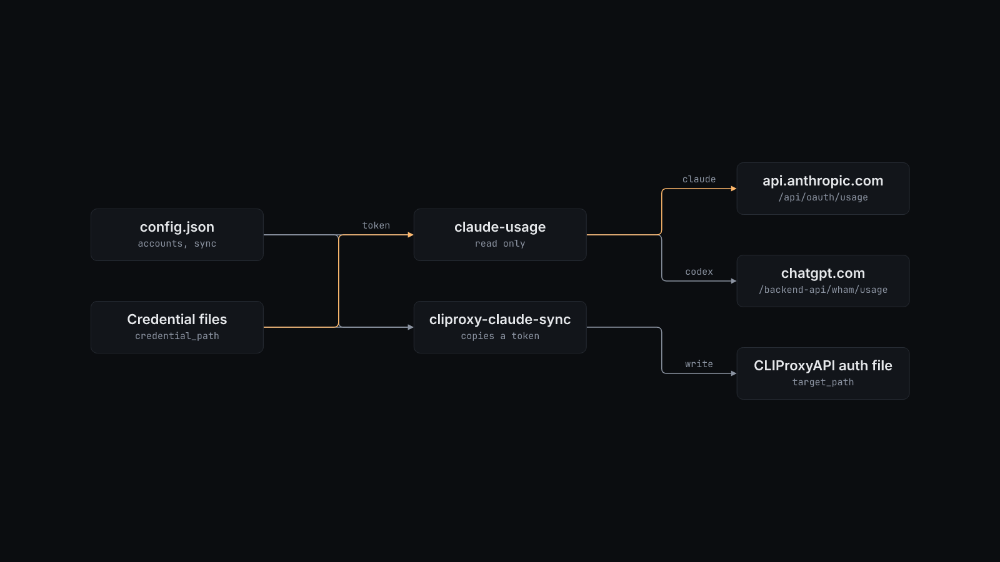

# How agent-usage works

## claude-usage

Reads `accounts` from the config and handles each account in order.

- **claude:** reads the access token from the credential file. It accepts Claude Code's `.credentials.json` (`claudeAiOauth.accessToken`) and files with a top-level `access_token` (the CLIProxyAPI auth file format). Calls `GET https://api.anthropic.com/api/oauth/usage` with the `anthropic-beta: oauth-2025-04-20` header and prints the `five_hour` and `seven_day` windows.
- **codex:** reads `tokens.access_token` and `tokens.account_id` from the Codex `auth.json`. Calls `GET https://chatgpt.com/backend-api/wham/usage` and prints the primary rate-limit window.

Each request has a 15-second timeout. An error on one account prints an `unreadable` line and does not stop the others. An unknown `kind` stops the script with a usage error.

## cliproxy-claude-sync

CLIProxyAPI can serve a Claude sign-in to other tools, but if it refreshes the token itself, Claude Code and the proxy fight over the same sign-in. This script lets Claude Code keep renewal and gives the proxy a copy of the access token with no refresh token.

It reads the `sync` section and loads `claudeAiOauth` from `credential_path`. If the token expires in less than 45 minutes, it runs `claude -p ok --model claude-haiku-4-5-20251001` once so Claude Code renews the sign-in, then reads the file again. It updates `target_path` in place: `access_token` gets the new token, `refresh_token` becomes empty, `expired` and `last_refresh` get local timestamps, and `disabled` becomes `false`. Other fields stay. The write goes to a mode-600 temporary file in the same directory, which then replaces the target.
